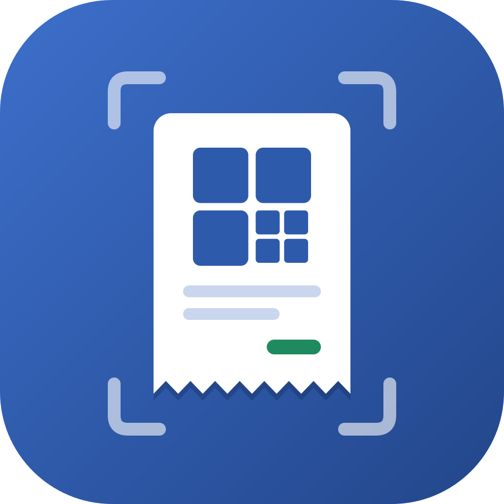

<p align="center"></p>

# Invoice2Sheet

An app to snap a picture of an invoice and place it on Google Sheets.

The product name is **Invoice2Sheet** (the codebase is still called Snap2Sheet). Scan an invoice's QR code and it's
parsed and appended as a row to a Google Sheet you choose, no typing required.

Read the [Privacy Policy](https://invoice2sheet.pedrovicente.pt/privacy.html) and the
[Terms of Service](https://invoice2sheet.pedrovicente.pt/terms.html). Their source is in
`composeApp/src/wasmJsMain/resources/`, and they are deployed with the web app. Use these URLs on
the Google OAuth consent screen.
A [demo video](docs/demo/invoice2sheet-demo.mp4) walks through the web app for OAuth reviewers.
See [`docs/demo/`](docs/demo/README.md) for how it's recorded.
Upload [`docs/logo/oauth-logo-120.png`](docs/logo/oauth-logo-120.png) (120×120 PNG) as the consent screen's
app logo.

To pass Google's brand verification, fill in the consent screen's Branding page like this:

- **App name:** `Invoice2Sheet`. It must match the name on the homepage. Google rejects names that
  contain Google product names such as "Google Drive".
- **Application home page:** `https://invoice2sheet.pedrovicente.pt/`. This is a public
  landing page (`index.html`) that describes the app and why it needs Google data. The app itself
  is served at `app.html`, so the homepage isn't behind a sign-in screen.
- **Privacy policy / Terms of service:** the two URLs above.

## Stack

Kotlin Multiplatform + Compose Multiplatform, targeting Android, iOS and Web (Kotlin/Wasm) from
one shared UI. See [ARCHITECTURE.md](ARCHITECTURE.md) for the layer breakdown.

- Kotlin Multiplatform / Compose Multiplatform
- Koin for dependency injection
- Coroutines + `StateFlow` for state
- Ktor (client) for the Google Sheets / Drive REST APIs
- kotlinx.serialization + kotlinx-datetime
- CameraX + ML Kit (Android), AVFoundation (iOS), BarcodeDetector/jsQR (web) for QR scanning

## Project layout

```
composeApp/          Shared KMP module
  src/commonMain/     domain/, data/, ui/ (screens, components, theme, navigation), di/
  src/androidMain/    Android actuals: KeyValueStore, Google auth (Identity AuthorizationClient), CameraX scanner
  src/iosMain/        iOS actuals: KeyValueStore, Google auth (ASWebAuthenticationSession + Keychain), AVFoundation scanner
  src/wasmJsMain/     Web actuals: localStorage, Google Identity Services, camera overlay (resources/fatura-bridge.js)
androidApp/           Android application entry point
iosApp/               iOS application wrapper (SwiftUI + Xcode project)
```

## How it works

1. **Set up once.** Sign in with Google, then pick a default **spreadsheet**, where each invoice
   becomes a row, and a default **Drive folder**, where invoice photos go. You can create new ones
   from the app.
2. **Scan the QR code.** The camera decodes the fiscal QR code printed on every Portuguese invoice
   (Portaria n.º 195/2020, e.g. `A:<NIF emitente>*B:<NIF adquirente>*…*H:<ATCUD>*…*O:<total>`).
   A code that isn't a Portuguese invoice is rejected on the spot. Android uses CameraX + ML Kit,
   iOS uses AVFoundation, and the web uses `getUserMedia` with `BarcodeDetector`, falling back to
   jsQR. An invoice without a readable code can be pasted as text or typed in.
3. **Photograph the whole invoice.** This uses the system camera or the photo library. On the web
   you can also pick a PDF. The photo is scaled down to at most 2000 px and kept on the device until
   it has been uploaded.
4. **Review.** Every field is editable. The QR code carries no merchant name, so you type it once
   and it's remembered for that NIF. NIF check digits, totals and missing ATCUDs are flagged, but
   they don't block saving.
5. **Save.** Saving goes to the defaults, or to a spreadsheet and folder you pick for this invoice.
   The save runs **in the background** in three steps. First, the ATCUD is checked against the
   sheet, so a duplicate uploads nothing. Then the photo is uploaded to the folder. Finally, the
   row is appended, with a link to the photo in a *Comprovativo* column. Each step is recorded as it
   completes, so a retry never uploads or appends twice.
6. **Retry.** Network hiccups are retried automatically with backoff: 5 s, 20 s, 1 min, 5 min,
   15 min. Anything that needs you, like an expired session or a deleted sheet, fails straight
   away and can be retried from History or from the banner on Home. Queued saves survive app
   restarts. On Android, WorkManager also finishes them after the app is closed, once there's a
   network. iOS asks for background time to finish the save in progress. The web only works while
   the tab is open.
7. **Notification.** A local notification fires when each invoice finishes: saved, skipped as a
   duplicate, or failed. You can turn this off in Settings.

The append rules in Settings apply to every row. *Match columns by header* fills your existing
columns by name (Portuguese or English, accents ignored). *Skip duplicate invoices* compares
ATCUDs. *New sheet tab each month* writes to a `YYYY-MM` tab by invoice date.

## Google setup

Fatura needs an OAuth client per platform in a Google Cloud project:

1. Enable the **Google Sheets API** and the **Google Drive API**.
2. Configure the OAuth consent screen with the scopes `…/auth/spreadsheets`, `…/auth/drive`,
   `email` and `profile`. The `drive` scope is needed to list your spreadsheets and folders and to
   upload into a folder you chose. It's a *restricted* scope, so add yourself as a test user while
   the app is in testing.
3. Create the clients:
   - **Android**: package `org.neteinstein.snap2sheet` plus the SHA-1 of the signing key. For debug
     builds that's `keytool -list -v -keystore ~/.android/debug.keystore -alias androiddebugkey -storepass android`.
     No ID goes in the code, because Google matches the package and certificate.
   - **iOS**: bundle ID `org.neteinstein.snap2sheet`.
   - **Web application**: add the site's origins as *Authorized JavaScript origins*, e.g.
     `http://localhost:8080` and `https://invoice2sheet.pedrovicente.pt`.
4. Give the build the iOS and web client IDs. Each one is read from a Gradle property, then an
   environment variable, then the git-ignored `local.properties`:

   ```properties
   google.webClientId=1234-abc.apps.googleusercontent.com   # or GOOGLE_WEB_CLIENT_ID
   google.iosClientId=1234-def.apps.googleusercontent.com   # or GOOGLE_IOS_CLIENT_ID
   ```

A build without a client ID for its platform can still connect Google. The Connect Google screen
asks for the client ID instead: tap **Enter OAuth client ID** and paste your client's ID. The
screen shows what the client needs, which is the page's origin on the web and the bundle ID on iOS.
The ID is saved on the device and can be changed or removed from the same screen. Android never
needs one.

## Building

```bash
./gradlew :androidApp:assembleGithubDebug        # flavors: github (sideloaded APK), playstore (Play bundle)
./gradlew :composeApp:testAndroidHostTest     # shared unit tests (also: iosSimulatorArm64Test, wasmJsTest)
```

iOS: open `iosApp/iosApp.xcodeproj` in Xcode, or build the `composeApp` framework via Gradle
first (`./gradlew :composeApp:embedAndSignAppleFrameworkForXcode` from Xcode's build phase, as
usual for a KMP project).

Web:

```bash
./gradlew :composeApp:wasmJsBrowserDevelopmentRun   # dev server with hot reload
./gradlew :composeApp:wasmJsBrowserDistribution      # production build -> composeApp/build/dist/wasmJs/productionExecutable
```

## Web deployment

Pushes to `main` build the Kotlin/Wasm web target and publish it to GitHub Pages via
[`.github/workflows/deploy-web.yml`](.github/workflows/deploy-web.yml). Enable Pages for the
repo once under Settings → Pages → Source → GitHub Actions, and set the `GOOGLE_WEB_CLIENT_ID`
repository variable (Settings → Secrets and variables → Actions → Variables) to enable Google
sign-in on the deployed site.

## Android releases

Every push to `main` (or a manual run) runs [`.github/workflows/release.yml`](.github/workflows/release.yml):

1. Fails fast if the signing secrets are missing.
2. Runs the shared unit tests (`:composeApp:testAndroidHostTest`) on the exact merged commit.
3. Decodes the keystore and builds `:androidApp:assembleGithubRelease` and
   `:androidApp:bundlePlaystoreRelease`, both signed and minified, with `versionCode = run number`
   and `versionName = 1.0.<run number>` (`APP_VERSION_CODE` / `APP_VERSION_NAME`).
4. Creates a GitHub Release `v1.0.<run number>` with `Snap2Sheet_version1_0_<n>-github.apk`,
   `Snap2Sheet_version1_0_<n>-playstore.aab`, each flavor's R8 mapping and the APK's SHA-1.
5. **Publishes to Google Play** with `:androidApp:publishPlaystoreReleaseBundle` when the
   `ANDROID_PUBLISHER_CREDENTIALS` secret is set. The bundle goes to the `internal` track, or to the
   track in the `PLAY_TRACK` variable (`alpha`, `beta`, `production`). Without the secret the step
   is skipped with a notice, not failed.

The two flavors share the application id `org.neteinstein.snap2sheet`. The `github` flavor can
never be uploaded to Play: Gradle Play Publisher is enabled for `playstore` only. Play release notes
live in `androidApp/src/playstore/play/release-notes/`.

### Secrets (Settings → Secrets and variables → Actions)

| Secret | Value |
|---|---|
| `KEYSTORE_BASE64` | The upload keystore, `base64 -w0 release.keystore` |
| `KEYSTORE_PASSWORD` | Keystore password |
| `KEY_ALIAS` | Key alias |
| `KEY_PASSWORD` | Key password |
| `ANDROID_PUBLISHER_CREDENTIALS` | *(optional)* Play service-account JSON key |

Add the release key's SHA-1 to the Android OAuth client (Google setup above). For the Play build,
add the **Play App Signing** key's SHA-1 from the Play Console too. Without it, Google sign-in fails.

### One-time Google Play setup

1. Create the app in the Play Console (package `org.neteinstein.snap2sheet`) and enrol in Play App
   Signing. The keystore in `KEYSTORE_BASE64` is the **upload key**.
2. **Upload the first bundle by hand.** The Play Developer API can only publish updates. Take the
   `.aab` from a GitHub Release and upload it to the internal track in the Play Console.
3. In Google Cloud, create a service account with a JSON key. Then in the Play Console → Users and
   permissions, invite its e-mail with release permissions for this app.
4. Add the JSON key as the `ANDROID_PUBLISHER_CREDENTIALS` secret, and optionally `PLAY_TRACK` as a
   variable.

A `403 PERMISSION_DENIED` from the upload means the service account isn't set up yet. The usual
causes are: it wasn't invited to the app, there was no first manual release, the API isn't enabled,
or a permission is still propagating (this can take up to a day).
